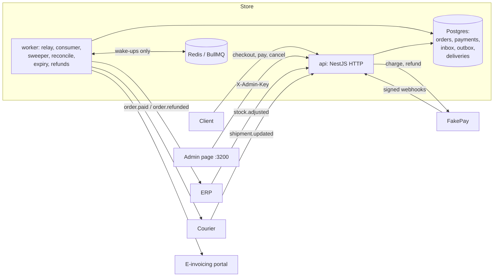

# Orders and payments backend

The order and payment core of a fictional online store, "Mithal Store", selling Saudi products
priced in SAR with 15% VAT included. It covers checkout with stock reservation, payment through a
gateway that answers by webhook, and order events delivered to an ERP, a courier and an e-invoicing
portal. Each of those can be down, slow, flaky, duplicated or out of order.

The repo is about the failure cases more than the happy path: what happens when a webhook arrives
twice, arrives before the event it follows, or never arrives; when the gateway charges but its
response is lost; when the ERP is down for an hour; when the process crashes between committing and
publishing; when Redis loses its queue. Every one of those has a test that injects the failure and
then checks the database and what each external system actually did.

NestJS · PostgreSQL 17 · Redis 8 + BullMQ · Prisma 7 · Next.js admin page · k6 · Docker Compose.
The payment gateway, ERP, courier and e-invoicing portal are fakes in this repo (`fakes/`) with
deterministic failure modes. Nothing here talks to a real provider.

## Run it

```sh
docker compose up -d --build
curl -s localhost:8100/health/ready   # {"status":"ready","db":"ok","redis":"ok","migrations":3,"products":12}
```

| Service | URL (127.0.0.1 only) |
|---|---|
| Store API + OpenAPI | http://localhost:8100, docs at `/docs` |
| Admin page | http://localhost:3200/admin (dev key `dev-admin-key`) |
| Fakes (gateway, ERP, courier, portal) | http://localhost:8200 |
| Postgres / Redis | 5436 / 6380 |

No keys are needed. Every secret has a dev-only default (see `.env.example`).
`docker compose down -v` resets everything.

## What it guarantees, and what it doesn't

Networks give at-least-once delivery, so the guarantee is **exactly once in effect**: every message
may arrive more than once, and every receiver turns repeats into no-ops.

| Guarantee | How |
|---|---|
| Stock never oversold, never negative | One conditional `UPDATE … WHERE stock >= qty` per line, rows locked in SKU order (no deadlocks), plus `CHECK (stock >= 0)`. Units the ERP removes while orders hold them are owed (`shortfall`) and repaid by a cancel, expiry or restock before they become sellable again |
| A retried request has one effect | `Idempotency-Key` on every money- or stock-changing call; the key, the effect and the stored response commit in **one transaction**, so a crash leaves no half-done key |
| A payment is charged once | The payment row is committed *before* the gateway call and sent as the merchant reference with the same idempotency key, so a lost response is found by lookup instead of charged again |
| Webhooks applied once, in any order | HMAC over the raw body with a ±5 min window; inbox row, state change and outbox event in one transaction; order transitions under a row lock; a success arriving for an expired order is refunded automatically |
| An event is never lost between DB and queue | Transactional outbox; the relay claims rows with `SKIP LOCKED`, records one delivery per destination and marks them published in one transaction, then enqueues |
| Postgres, not Redis, is the source of truth | Attempts, backoff, leases and dead letters live in the `deliveries` table; BullMQ only carries wake-ups. A wiped Redis costs time, never a delivery (a sweeper re-enqueues) |
| Each external system hears an event once | `Idempotency-Key: <event id>:<destination>`, 8 attempts with jittered backoff (1 s → 5 min), then dead letter + replay. A refund never reaches a system before its sale (per-order ordering, `blocked` behind a dead sale) |
| Tracking never moves backwards | Courier statuses applied only if newer (`statusSeq`), with a conditional update |

**Limits, stated plainly:**
- Exactly-once depends on the receiver deduplicating by idempotency key. The fakes do; a real
  system that ignores the key could double-book, and no sender can prevent that.
- A delivery handler treats every non-2xx as retryable, so a permanent 4xx uses all 8 attempts
  before it is dead. A permanent-failure path would be the next change.
- Invoice numbers come from a Postgres sequence. A rare race after a lease expiry can leave a gap.
  Gap-free numbering needs a locked counter row.
- The e-invoicing integration is ZATCA-*style* (UUID, clearance id, line VAT), not certified.
- The fakes are code in this repo, so a passing test proves the store against *these* fakes. Their
  rules (final charge outcomes, retries until 2xx, dedupe by key) mirror common provider contracts.

## Architecture



One codebase, two entry points: `api/src/main.ts` (HTTP) and `api/src/worker.ts` (relay every
200 ms; sweeper, payment reconciliation, refund retries and order expiry every 30 s).

- **Order:** `pending_payment` → `paid` → `refunded`, or `cancelled` / `expired`. A checkout holds
  stock for 15 minutes.
- **Payment:** `pending` → `succeeded` | `failed`; `succeeded` → `refunded`. Final states never move.
  A payment pending for 2 minutes is looked up at the gateway by our reference.
- **Events:** `order.paid` → ERP sale, courier shipment, invoice. `order.refunded` → ERP refund
  receipt, credit note.

## Failure injection: what is proven

`api/test/failure-injection.e2e-spec.ts` runs the HTTP app, the worker and the real fakes together.
It switches the fakes' modes and asserts durable state plus every system's ledger: one charge, one
ERP sale, one shipment and one invoice per paid order.

| Scenario | Outcome checked |
|---|---|
| Baseline paid order | each system once |
| FakePay sends every webhook twice | paid once, one `order.paid`, each system once |
| FakePay loses the webhook | reconciliation pays it; each system once |
| FakePay loses its HTTP response | webhook settles it; one charge |
| Payment succeeds after the order expired | refunded automatically; ERP, courier and portal hear nothing |
| Paid then refunded, webhooks released newest first | one sale, one refund receipt, one credit note |
| ERP down, then back | retried, booked once |
| ERP down past all 8 attempts | dead letter → replay after recovery → booked once |
| Relay crashes right after committing | sweeper delivers everything once |
| Relay publishes twice, jobs enqueued again | one effect per system |
| Redis loses every queued job | sweeper re-enqueues from Postgres |
| Courier tracking duplicated, then out of order | ends `delivered`, never moves back |
| E-invoicing portal flaky | one invoice, one number |
| ERP stock webhooks duplicated | adjustment applied once |
| Cancel and pay racing (20 rounds) | never a cancelled order with a charge that isn't refunded |

Also proven in their own files: 50 parallel checkouts for 10 units → exactly 10 orders; the same key
sent 10 times at once → one order; settle vs expiry racing (both orders occur, one winner every
round); opposite-order multi-line checkouts don't deadlock; an ERP adjustment below zero clamps at
0 and records the shortfall; bad signatures are 401 and never stored.

## Load test

200 virtual users each check out 1 unit of a product with 50 in stock, then pay
(`load/checkout.js`, k6 in Docker, everything on one laptop):

```sh
THROTTLE_LIMIT=100000 docker compose up -d api   # lift the per-IP limit for one IP sending 250 requests
load/run.sh                                      # reset → k6 → invariant check
docker compose up -d api                         # back to the default limit
```

| | Result |
|---|---|
| Checkouts | 50 × 201, 150 × 409 `out_of_stock`, 0 unexpected |
| Paid orders / FakePay charges | 50 / 50, all distinct merchant references, 0 refunds |
| Stock after the run | 0 (never negative) |
| Checkout latency | p50 359 ms, p95 394 ms |
| Pay latency (202, outcome by webhook) | p50 294 ms, p95 376 ms |

The load test found a real bug, in the fakes. Their gateway read its failure mode through the
connection pool while holding a transaction, so 10+ simultaneous charges exhausted the pool. Pay
p50 was 5.2 s and 41 of 50 payments were only settled by reconciliation. The end state was still
correct (50 paid, no duplicates), which is the point of reconciliation, but the latency was not.
Fixed with a failing test first.

## Admin page

`/admin` shows orders (status filter in the URL), an order's timeline (payments, webhooks, outbox
events, deliveries with attempts and last error, shipment, invoices), dead letters with Replay,
stock adjustments with shortfall, and the fake systems' modes. Switch the ERP to `down`, pay an
order, and the ERP delivery fails 8 times and appears under dead letters. Switch it back and press
Replay: it is delivered once. The admin key is typed into the page and kept in session storage,
never built into the bundle. Mode changes go through the API, so the browser never sees the fakes'
control key.

## Tests and checks

```sh
cd api   && pnpm lint && pnpm format:check && pnpm typecheck && pnpm test && pnpm test:e2e
cd fakes && pnpm lint && pnpm format:check && pnpm typecheck && pnpm test:e2e
cd web   && pnpm lint && pnpm typecheck && pnpm build
```

18 unit tests (money and VAT, webhook signatures, backoff, config), 86 api e2e tests and 15 fakes e2e tests. The e2e tests run
against real Postgres, Redis and the fakes on throwaway databases; `E2E_SLOT=n` gives a run its own
databases, ports and Redis db so several checkouts can test at once. CI runs all of it on every push.

## Layout

```
api/     store: src/{catalog,orders,payments,webhooks,idempotency,outbox,destinations/{erp,courier,invoicing},admin,health,common}
fakes/   FakePay, ERP, courier, e-invoicing portal, control + ledger endpoints, webhook sender
web/     Next.js admin page
load/    k6 script and run/check script
docs/sdlc/  intent, spec and plan for this change, including every departure from the plan
```

## How it was built

Built with Claude Code as a pair, following a written chain: `docs/sdlc/…/intent.md` (what and why),
`spec.md` (requirements, flagged concerns, and 14 amendments from an independent review), and
`plan.md` (order of work, risks, proof, and a "Departures from plan" log written as the work
happened). `CLAUDE.md` holds the repo's working rules for the agent; `REVIEW.md` holds the review
passes. Steps 7, 9 and 10 (ERP, courier and invoicing consumers, admin, load test) were built in
parallel by five agents in separate git worktrees, then merged and re-verified. Bugs were fixed
test-first: the failing test is committed before the fix.
